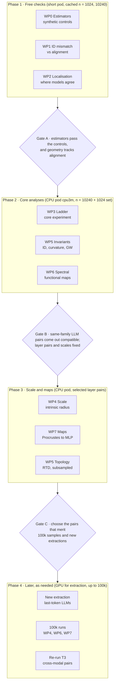

# Geometry-aware PRH: wrong ruler or incompatible manifolds?

2026-10-17 · oddharak · exported from the [Claude doc](https://claude.ai/code/artifact/d90b2722-a72a-407f-99db-e6f8c3725ebf); edit this copy in the repo

We propose eight work packages that test whether the Platonic and Aristotelian hypotheses disagree because Euclidean metrics are the wrong ruler for curved representations (H1), or because the representation manifolds are intrinsically incompatible (H2). The plan starts with free checks on cached data and puts confound-free intra-LLM comparisons first; cross-modal LLM-ViT results are read against them until comparable extractions exist.

## Background and motivation

Our results so far say the representations are low-dimensional but far from flat, so metrics built on straight-line distance may be measuring the wrong thing.

**The two hypotheses.** The Platonic Representation Hypothesis (PRH; Huh et al., 2024) says that networks trained on different data and modalities converge toward a shared statistical model of reality. Its evidence is that alignment scores (mutual kNN, CKA) between language and vision models rise with scale. The Aristotelian view (ARH; Gröger, Wen and Brbić, 2026) shows that these scores are inflated by model width and depth. After permutation-null calibration, the global convergence disappears and only local neighbourhood agreement survives. PRH and ARH therefore disagree about the *global* structure and agree about the *local* one.

**What we found so far.**

| Experiment | Finding | Why it matters here |
| --- | --- | --- |
| exp-004 to exp-008 | The apparent CKNNA peak at intermediate k was the chance level; uncalibrated scores mislead | Every score in this plan must be calibrated against a null |
| exp-010 (ID) | Intrinsic dimension (ID) is 20-60 in LLMs, 8-44 in ViTs. LLM ID falls with depth, ViT ID rises; the two meet at \~20-35 in late layers | The manifolds are low-dimensional and differ by modality and depth |
| exp-010 (PCA) | LLMs need 10-25x more principal components than their ID at every layer. ViTs are near-linear early and nonlinear late | The data does not lie on a flat subspace; linear and Euclidean metrics see a different object than local ones |
| exp-010 (raw vs PRH) | In raw LLM activations one outlier direction holds >90% of the variance (massive activations); the PRH clamp and l2 norm remove it | Preprocessing is already a choice of geometry |
| exp-010 (pooling) | LLM features are mean-pooled captions, ViT features are CLS tokens; this likely shapes the LLM ID profile | Cross-modal geometric comparisons carry a confound |

**The thesis.** CKA compares global, linear structure; mutual kNN compares local neighbourhoods using Euclidean (or cosine) distance. On a curved manifold whose linear spread is an order of magnitude larger than its intrinsic dimension, neither is measuring the manifold itself. Two outcomes are possible, and this plan is designed to tell them apart:

- **Wrong ruler (H1).** Measured in the manifold's own geometry, models agree more and the global/local gap shrinks. PRH and ARH would then be two readings of one fact.
- **Incompatible manifolds (H2).** The manifolds differ in properties that no choice of distance can remove, such as dimension, curvature or topology. Alignment is then bounded from above, and we can say by how much and where.

The idea of a graded series of distance metrics comes from PersonaManifold (Xu et al., 2026, Section 4.1). They separate the effects of anisotropy and curvature by moving from Euclidean to Mahalanobis to graph geodesic to a locally weighted geodesic. They evaluate inside one model against behavioural ground truth. We apply the same series *between* models, where the paired inputs are the only ground truth.

## Primer: the geometric ideas in this plan

Each idea below gets the intuition and the reason we need it; the maths can follow per work package.

### Manifold, intrinsic and linear dimension

A manifold is a shape that looks flat when you zoom in far enough, like the Earth's surface seen from a street. Its *intrinsic dimension* (ID) is how many numbers you need to move around on it locally: 2 for a sheet of paper, however crumpled. The *ambient dimension* is the size of the space it sits in (4096 for a LLaMA hidden state). The *linear dimension* (PCA90) is how many flat directions you need to cover 90% of the variance. A crumpled sheet has ID 2 but a much larger linear dimension, which is exactly the LLM pattern in exp-010.

### Geodesic vs Euclidean distance

On a curved manifold, the straight line between two points cuts through empty space. The *geodesic* is the shortest path that stays on the manifold, like a flight route over the globe compared with a tunnel through it. From samples we approximate it with a *kNN graph*: connect each point to its k nearest neighbours, then take shortest paths through the graph (Isomap; Tenenbaum et al., 2000). Two points close in Euclidean distance but far apart along the manifold (the two layers of a rolled-up sheet) are told apart only by the geodesic.

### Anisotropy, Mahalanobis and the local metric

Euclidean distance treats every direction alike. In real representations some directions vary a lot and others hardly at all, which is *anisotropy*. Mahalanobis distance rescales each direction by its spread, so a step along a rare direction counts as farther:

```latex
d_M(x,y)^2 = (x-y)^\top \Sigma^{-1} (x-y)
```

The global version uses one covariance Sigma for all data. PersonaManifold uses a *local* covariance around each point, so the rescaling changes from place to place. That local rescaling is what a Riemannian metric tensor is: a ruler that varies over the manifold.

### Curvature, and three ways to estimate it from samples

Curvature says how the manifold bends. On a sphere (positive curvature), paths that start parallel converge, and triangles are "fat". On a saddle or a tree-like space (negative curvature), paths diverge and triangles are "thin". A flat sheet has zero curvature. Rolling a flat sheet into a cylinder does not change its intrinsic curvature: curvature is a property of distances *within* the manifold, not of how it sits in space.

- **Ollivier-Ricci curvature** (Ollivier, 2009) compares two neighbouring points with their neighbourhoods. If the neighbourhoods are closer to each other than the points are (cheap to transport one onto the other), curvature is positive. If they are farther, it is negative. It is local and per-edge, but on a kNN graph a bridge between two clusters also looks negatively curved.
- **Gromov delta-hyperbolicity** (Gromov, 1987) measures how close the whole space is to a tree, using the four-point condition on sampled quadruples. Small delta means tree-like (negatively curved, hierarchical). It is global and cheap, and Khrulkov et al. (2020) used it on image embeddings.
- **Best constant-curvature fit**: embed the data in a hyperbolic, flat or spherical space of dimension about the ID, and see which curvature distorts distances least (Gu et al., 2019 do this with product spaces).

### Diffusion, the graph Laplacian and the heat kernel

Imagine heat spreading over the kNN graph, or a random walker hopping between neighbours. After a short time t, heat has only reached nearby points; after a long time it has spread across the whole manifold. The *heat kernel* at time t is a similarity between every pair of points, so t is a natural, intrinsic scale knob: small t is local, large t is global (Coifman and Lafon, 2006). The *graph Laplacian* is the operator that drives this spread. Its eigenvectors are the manifold's vibration modes, its own Fourier basis: the first few vary slowly across the whole shape, later ones oscillate over small regions.

### Functional maps

Given two manifolds and their Laplacian eigenbases, a *functional map* (Ovsjanikov et al., 2012) is the matrix C that expresses one basis in terms of the other. If the two shapes are isometric (same distances), C is close to diagonal: mode i of one model is mode i of the other. If only coarse structure is shared, C is diagonal for the first modes and smeared for later ones. Since our points are paired, we can compute C directly, and its shape tells us at which scales the models agree.

### Invariants: what "cannot be aligned" means

An *invariant* is a property that a given class of transformations cannot change. If two manifolds differ in an invariant, no transformation in that class maps one onto the other. The classes are nested, from strict to loose:

| Transformation class | Intuition | Keeps | Alignment notion that needs it |
| --- | --- | --- | --- |
| Rigid (rotation, reflection) | Turn the object | All Euclidean distances | Euclidean RSA, Procrustes |
| Linear | Turn and stretch | Straight lines, linear structure | Linear CKA |
| Isometry | Bend without stretching | Geodesic distances, curvature | GW, geodesic-distance metrics |
| Bi-Lipschitz / smooth bijection | Bend and stretch by a bounded amount | Dimension, rough neighbourhoods | Mutual kNN, approximately |
| Homeomorphism | Any continuous deformation without tearing | Dimension, topology (holes, components) | Any continuous alignment |

So differing curvature rules out an isometry but not a neighbourhood-preserving map. Differing ID or topology rules out every continuous map, which is the strongest form of "incompatible".

### Gromov-Wasserstein (GW)

GW compares two point clouds that live in different spaces, with no shared coordinates. It looks for a matching between points of A and points of B that preserves pairwise distances as well as possible (Mémoli, 2011):

```latex
\mathrm{GW}(A,B) = \min_{\pi} \sum_{i,j,k,l} \big| d_A(i,k) - d_B(j,l) \big|^2 \, \pi_{ij} \, \pi_{kl}
```

Three quantities matter for us. The *identity coupling* uses our known pairing (image i with its caption i) and measures its distortion. The *optimal coupling* is the best matching any correspondence could achieve. *Lower bounds* computed only from each cloud's own distance distributions say that even the best matching cannot do better than this. If the lower bound is already large, the two shapes cannot be aligned by any correspondence.

### Trustworthiness and continuity

These come from dimensionality-reduction evaluation (Venna and Kaski, 2006). *Trustworthiness* asks whether B's neighbours were also neighbours in A; *continuity* asks the reverse. They are asymmetric on purpose. If B is a projection of A (A carries extra information that B drops), points that were far in A can collapse together in B, so one score stays high while the other falls. This tests for a shared quotient instead of a full match.

### Persistent homology and RTD

Topology counts features that survive any continuous deformation: connected pieces, loops, voids. *Persistent homology* grows a ball around every point and records when such features appear and disappear as the radius increases. The result is a *barcode*: long bars are real structure, short ones noise. *Representation Topology Divergence* (RTD; Barannikov et al., 2022) compares two representations of the *same* points this way, so it uses our pairing directly.

### Calibration

Any similarity score has a chance level that depends on n, dimension and model size. The ARH calibration (permutation null) shuffles the pairing many times, recomputes the score each time and reports how far the real score sits above that null. exp-008 showed that skipping this step creates fake structure, so every score in this plan is calibrated.

### Map complexity and distortion

Another way to ask whether two representations match is to fit a map from one to the other and see how complex it must be. If a rotation suffices, they match rigidly; if a smooth nonlinear map is needed, they match up to a change of coordinates. The map's local stretching (singular values of its Jacobian) bounds how much it distorts distances: its *bi-Lipschitz* constants. This links model stitching (Bansal et al., 2021) to the invariant view above.

## Hypotheses and research questions

We test three hypotheses that make different predictions on the same measurements, so each work package can support or weaken each one.

- **H1, wrong ruler.** The models share a manifold, but Euclidean and linear metrics distort it. Measured geodesically or intrinsically, calibrated alignment rises and the PRH/ARH gap shrinks.
- **H2, incompatible manifolds.** The models' manifolds differ in invariants (ID, curvature profile, topology) by more than the null allows. No distance choice can align them beyond a bound we can estimate.
- **H3, shared quotient (the likely middle ground).** The models share coarse structure, but each adds modality-specific fine structure. Alignment holds at large intrinsic scales and in a projection, not between the full manifolds. Captions carry information images do not (and vice versa), so some H3 is expected even if PRH is true.

| Research question | H1 predicts | H2 predicts | H3 predicts | Work package |
| --- | --- | --- | --- | --- |
| RQ1: Does alignment rise when distances follow the manifold? | Calibrated scores rise along the distance ladder | Scores stay flat or fall | Scores rise for the coarse rungs (diffusion at large t), not the fine ones | WP3 |
| RQ2: Does a mismatch in ID predict misalignment? | Weak relation once depth is controlled | Strong negative relation | Moderate relation, mostly through fine-scale metrics | WP1 |
| RQ3: Where and at what scale do models agree? | Agreement extends to large intrinsic scales | Agreement only where both manifolds are dense and flat | Agreement at coarse scales, lost at fine ones | WP2, WP4, WP6 |
| RQ4: Do invariants differ beyond the null? | Within the spread of compatible reference pairs | Beyond it; the GW lower bound exceeds the null | Coarse invariants match, fine ones differ | WP5 |
| RQ5: How complex is the best map between models? | A smooth map with bounded distortion aligns them on held-out data | No map generalises, or distortion is large | One direction works and the other does not | WP7 |

The intra-LLM comparisons give a reference point. Models of one family trained on similar text should be the most compatible pairs we have. If even they look incompatible under a measure, that measure is too strict or too noisy to support an H2 claim across modalities.

## Data and comparison design

We use only cached activations for now and organise every analysis into three tracks, two of which are free of the pooling confound.

### Cached data

| Set | Models | n | Features |
| --- | --- | --- | --- |
| PRH WIT (`wit_1024`) | 10 LLMs: BLOOMZ 560m, 1b1, 1b7, 3b, 7b1; OpenLLaMA 3b, 7b, 13b; LLaMA 7b, 13b. 17 ViTs: IN21k, MAE, DINOv2, CLIP, CLIP-ft-IN12k, tiny to giant | 1024 | LLM: mean-pooled caption, every layer. ViT: CLS token, every block |
| WIT-1M first 10240 (`wit1m10k`) | 3 LLMs: BLOOMZ 560m, 1b1, 1b7. 5 ViTs: IN21k tiny and small, DINOv2 small, MAE base, CLIP base | 10240 | Same as above |

### Three comparison tracks

| Track | Pairs | Confound-free? | Role |
| --- | --- | --- | --- |
| T1 intra-LLM | Within BLOOMZ (sizes); across families (BLOOMZ, OpenLLaMA, LLaMA). LLaMA vs OpenLLaMA is the same architecture trained on different data | Yes: same captions, same pooling | Primary track for clean claims. Same-family pairs serve as the "compatible" reference |
| T2 intra-ViT | Across training objectives (supervised, MAE, DINOv2, CLIP) and sizes | Yes: CLS throughout | Tests whether the training objective alone changes the geometry |
| T3 LLM-ViT | The PRH pairs | No: mean pooling vs CLS | The question PRH asks. Read against the T1 and T2 spread until last-token extractions exist |

A cross-modal difference counts as evidence for H2 only if it clearly exceeds the spread within T1 and T2. A difference of the same size as between two BLOOMZ sizes says nothing about modality.

At n = 10240, T1 has only the three BLOOMZ sizes (3 pairs), T2 has 10 pairs and T3 has 15. Cross-family T1 is available only at n = 1024 for now.

### Layer pairs

Cheap measures (ID, mutual kNN, CKA) run on every layer pair at n = 1024. Expensive measures run on a fixed set per model pair: relative depths 0, 0.25, 0.5, 0.75 and 1, the best calibrated layer pair, and the layer pair whose IDs match most closely. Adjacent layers of one model give a second compatible reference.

### Nulls and controls

- **Permutation null** for every score: the ARH calibration, as in exp-008 and `prh_val_calibrated`, with FDR control over layer pairs.
- **Compatible references:** adjacent layers of one model and neighbouring sizes within a family. Their spread is the yardstick for "different".
- **Synthetic positive controls:** take one model's representation and apply transformations with a known answer: a rotation (isometric), a smooth warp (same topology, different distances), a projection that drops dimensions (a quotient), added noise. Every measure must classify these correctly before we trust it on real pairs (WP0).

### Preprocessing

The PRH geometry (0.95 outlier clamp, l2 norm) is the default, because it is what the alignment metrics see. Raw activations are a secondary check for LLMs, where massive activations dominate raw distances. We do not reduce with PCA by default, since the LLM spectrum is heavy-tailed (exp-010); PCA to 99% of the variance, as in PersonaManifold, is a robustness check.

### Sample size

We start at n = 1024 (all 27 models) and n = 10240 (8 models), and move selected pairs to up to 100k later. More samples help the geodesic graph (shortcuts across the manifold disappear as it fills in) and reduce the downward bias of ID estimators. They help less with local curvature than one might hope. At ID about 25, neighbour distances shrink like n to the power 1/25, so 10 times more samples shrinks neighbourhoods by only about 9%. Curvature estimates at our ID will always describe fairly large neighbourhoods, which is why WP0 checks whether they work at all.

At 100k a full distance matrix takes 40 GB in float32, so those runs use sparse kNN graphs, landmark geodesics, subsampled GW and sparse eigensolvers, never full matrices.

## Work packages

Eight work packages: WP0 validates the tools, WP1 and WP2 are free checks on cached data, WP3 to WP7 are the main analyses. Each lists its motivation, intent, method, expected outcome and cost.

### WP0: Validate the estimators on synthetic manifolds

**Motivation.** exp-010 showed that ID estimators disagree with each other and drift with n. Curvature at ID around 25 is harder still. An incompatibility claim is only as strong as the estimators behind it.

**Intent.** Find out which measures can tell a compatible pair from an incompatible one at our n and ID, before running them on models.

**Method.**

- Synthetic manifolds embedded in 1024 dimensions with small noise, at ID 5, 20 and 40 and n = 1k and 10k: a flat subspace, a sphere, a hyperbolic (tree-like) set, a mixture of separated flat clusters, and a curved high-dimensional sheet.
- Pairs with a known answer: an isometric copy, a smooth warp, a projection that drops dimensions, a different ID, a different topology (sphere vs flat), and curvature vs clustering.
- The same transformations applied to one real model's representation, as described under Nulls and controls.
- Every measure from WP3, WP5 and WP6 is run on all of them.

**Expected outcome.** ID and geodesic distortion separate the cases at n = 10k. Delta-hyperbolicity separates tree-like from flat and spherical data. Ollivier-Ricci curvature will likely mistake separated clusters for negative curvature and degrade at ID 40.

**Cost.** Laptop or a small CPU pod, a few hours.

**Decision gate.** A measure that misclassifies the controls is dropped or reported as exploratory only.

### WP1: Does ID mismatch predict misalignment?

**Motivation.** In exp-010, LLM and ViT IDs move toward each other and meet at about 20-35 in late layers, which is where cross-modal alignment usually peaks. If a mismatch in dimension limits alignment, this is direct and nearly free evidence for H2.

**Intent.** Answer RQ2 on every layer pair.

**Method.**

- Per-layer ID from exp-010 (Levina-Bickel and TwoNN, PRH geometry, n = 1024).
- Calibrated mutual kNN (k = 10) and linear CKA on every layer pair. The existing PRH results store only each pair's best layers, so these are recomputed; at n = 1024 that takes minutes per model pair.
- Rank correlation between the calibrated score and three mismatch measures: absolute ID difference, log ID ratio, and the difference in PCA90/ID (linear vs nonlinear structure). Computed within each model pair, then summarised per track.
- Relative depth is controlled for (partial correlation), since both ID and alignment change with depth.

**Expected outcome.** Under H2, a clear negative correlation that survives the depth control, in T1 as well as T3. If it appears in T3 only, the pooling confound is the first suspect.

**Cost.** Free (laptop or a short CPU pod).

**Caveat.** This is correlational, and ID is a one-number summary. A positive result motivates WP5 rather than replacing it.

### WP2: Where on the manifold do models agree?

**Motivation.** ARH says local agreement survives calibration, but not *where* it lives. If agreement concentrates in dense, flat regions, Euclidean neighbourhoods work only where the manifold is locally flat, which is the H1 or H3 story in miniature.

**Intent.** Answer RQ3 at the level of individual samples.

**Method.**

- Per-sample alignment: the overlap of each point's k nearest neighbours in the two models (k = 10 to 50), and the per-point local CKA from exp-009. Each is calibrated against a per-point permutation null.
- Per-sample geometry in each model: local ID, local density (distance to the k-th neighbour), local flatness (variance left outside the top-ID local principal components), hubness (how often the point is someone's neighbour), and caption length.
- Rank correlations, plus a comparison of the best- and worst-aligned deciles.

**Expected outcome.** Under H1 or H3, aligned points sit in dense, flat regions and misaligned points in sparse, curved ones or on hubs. If agreement is unrelated to local geometry, geometry does not explain ARH's local agreement, which weakens the whole programme early and cheaply.

**Cost.** Free, on cached data at n = 1024 and 10240.

**Output.** A map of which samples align, which also sets the scales studied in WP4.

### WP3: The distance ladder (core experiment)

**Motivation.** If H1 holds, measuring with the manifold's own geometry should reveal agreement that Euclidean metrics hide. PersonaManifold's graded series of distances lets us attribute any gain to one geometric factor at a time.

**Intent.** Answer RQ1, and find which factor (scale, anisotropy, curvature, local anisotropy) separates the models.

**Method.** Compute the distance matrix of each model at every rung, then score alignment between the paired matrices. Each rung ignores one more kind of difference than the rung before:

| Rung | Distance | Additionally ignores | A gain at this step means |
| --- | --- | --- | --- |
| R0 | Euclidean, raw activations | Nothing (baseline) | n/a |
| R1 | Cosine, PRH geometry | Overall scale, outlier dimensions | Magnitudes and massive activations hid agreement |
| R2 | Global Mahalanobis (shrinkage-whitened) | Any global linear stretch | Global anisotropy hid agreement |
| R3 | Isomap geodesic (kNN graph, Euclidean edges) | Bending without stretching | Curvature hid agreement |
| R4 | Locally weighted geodesic (PersonaManifold, Eqs. 3-4) | Stretch that varies from place to place | Curvature and local anisotropy interact |
| R5 | Diffusion / heat kernel at several times t | Graph shortcuts, noise; t sets the scale | Agreement exists at the scales where it rises |
| R6 | Neighbour ranks (mutual kNN as is) | Any order-preserving change of local distances | Only neighbourhood order is shared |

UMAP is left out: it is stochastic, not a metric, and fits its own embedding.

At each rung, three alignment scores on the paired samples:

- **Mutual kNN** on the rung's distances (local agreement).
- **CKA** on the Gram matrix built from the distances, the double-centred minus half squared distance matrix used in classical MDS. For Euclidean distance this equals linear CKA; at R2 it is close to mean squared canonical correlation (CCA). For R5 we use the heat kernel directly.
- **Distance distortion under the known pairing** (the identity-coupling GW cost), on distances normalised by their median.

All scores are calibrated against the permutation null. Graph rungs use k from WP0 (PersonaManifold uses k = 5 x ID) with a sensitivity check. We record the graph's connected components: a graph that splits into pieces is itself a topological finding.

**A trap to avoid.** A more invariant ruler can raise alignment simply by discarding information. In the limit, a ruler that ignores everything makes every pair identical. The calibrated score guards against this, because the null rises too, so we report the null at each rung next to the score.

**Expected outcome.**

- H1: calibrated scores rise from R1 to R5, and the gap between global (CKA) and local (mutual kNN) scores shrinks. That would reconcile PRH and ARH.
- H2: scores stay flat; no geometric factor helps.
- H3: gains appear only at the coarse end, diffusion at large t.
- Within T1, same-family pairs should gain the least, because they are already close.

**Cost.** At n = 10240, each distance matrix is 400 MB and all-pairs graph shortest paths take minutes. A memory-optimised CPU pod (cpu3m, 8 vCPU, 64 GB) holds several models at once. The 1024 set runs on a laptop.

### WP4: Alignment at matched intrinsic scale

**Motivation.** Our k-sweeps (exp-004, exp-005, exp-008) used k as the scale. But k neighbours cover a much larger part of a 20-dimensional manifold than of a 50-dimensional one, and more in sparse regions than dense ones. So the same k compares different scales in different models. PRH (global) and ARH (local) are the two ends of a single scale axis. The question is where on that axis agreement is lost, measured in each manifold's own units.

**Intent.** Answer RQ3 in terms of scale, and link the loss of agreement to the geometry of each model.

**Method.**

- Define scale intrinsically: geodesic radius as a fraction of the median geodesic distance, or diffusion time t.
- Alignment at scale s: overlap of each point's geodesic ball of radius s in the two models, and heat-kernel CKA at the matching t; calibrated at every scale.
- Each model's *flatness profile*: the local linear dimension (local PCA) as the neighbourhood grows. On a curved manifold a small patch looks flat, with dimension equal to the ID. As the patch grows it needs more and more directions. The radius where this departure starts is the model's flatness scale.
- Compare the scale at which alignment is lost with the two flatness scales.

**Expected outcome.** Under H1 or H3, agreement is lost near the scale where the manifolds stop being flat, and Euclidean metrics lose it sooner than geodesic ones. Under H2, agreement is low at all scales, or is lost at scales unrelated to flatness.

**Cost.** A CPU pod at n = 10240; it reuses the WP3 geodesic matrices. A prime candidate for the 100k runs, since large-scale geodesics need dense sampling.

### WP5: Invariants and incompatibility tests

**Motivation.** This is the reverse direction. Instead of looking for the right ruler, we look for differences that no ruler can remove. Each invariant rules out one class of alignment (see the invariants table in the primer), so the result says *how* incompatible two models are, not just whether they differ.

**Intent.** Answer RQ4: which invariants differ beyond the compatible-reference spread, and at which transformation class.

**Method.** Five parts, from cheapest to most expensive.

1. **Dimension.** ID per layer from several estimators, plus a scale-dependent ID (GRIDE; Denti et al., 2022) that shows how ID changes with neighbourhood size. Per-sample local ID is compared across models on the paired samples: does a caption that sits in a high-ID region of one model also sit in one in the other?
2. **Curvature signature.** Delta-hyperbolicity of each model's geodesic distances (relative to the diameter), and which constant-curvature space embeds each model with the least distortion. Ollivier-Ricci curvature, its distribution and its per-sample correlation across models are included only if WP0 shows it works at our ID, and always within density-matched bins as PersonaManifold does.
3. **Shared-quotient test.** Trustworthiness and continuity in both directions at k = 10 to 100. A strong asymmetry says one model is roughly a projection of the other, and tells us which one carries the extra structure.
4. **GW bounds.** Three numbers per pair: the distortion under the known pairing (an upper bound), the best coupling found by entropic GW (a local optimum, since the problem is non-convex), and a lower bound from each model's own distance distributions (cheap: one-dimensional transport problems). A lower bound above the null means no correspondence can make the two metric spaces match. A large gap between the known-pairing cost and the optimal cost means the shapes are similar but the pairing puts points in different places.
5. **Topology.** RTD on paired subsamples of 1-2k points, plus each model's own persistence barcode, at the selected layer pairs.

**Expected outcome.** Under H2, invariant differences and the GW lower bound exceed the T1 within-family spread for cross-modal pairs. Under H1, they stay within it. Under H3, coarse invariants (large-scale hyperbolicity, GRIDE at large scale) match while fine ones (local ID) differ, and trustworthiness/continuity is asymmetric.

**Cost.** Parts 1-4 on a CPU pod at n = 10240. Part 5 is the most expensive and runs last, on subsamples.

### WP6: Spectral comparison (heat kernel and functional maps)

**Motivation.** The Laplacian's eigenvectors are each manifold's own Fourier basis, ordered from coarse to fine. Comparing the two bases on paired samples asks, without any coordinates, which frequencies (scales) the models share. It is the cleanest mathematical form of "same manifold, wrong ruler".

**Intent.** Answer RQ3 and RQ4 in spectral terms: up to which scale do two models share structure?

**Method.**

- Build each model's kNN-graph Laplacian with the diffusion-maps normalisation, which removes most of the effect of uneven sampling density.
- Take the first 50-200 eigenvectors with a sparse eigensolver and form the functional map between the two bases on the paired samples.
- Summarise how much of the map's weight lies near the diagonal, as a function of mode number. Eigenvectors with nearly equal eigenvalues can swap or mix, so we measure near-diagonal blocks, not strict diagonality.
- Compare the eigenvalue sequences. Their growth rate encodes the dimension (Weyl's law), which gives one more independent ID estimate.
- Heat-kernel CKA across t is shared with WP3 (rung R5).

**Expected outcome.** Under H3, the map is near-diagonal for the first modes and smeared beyond a cut-off; that cut-off mode is the shared scale. Under H1, it stays near-diagonal far into the spectrum. Under H2, it is smeared from the start.

**Cost.** Cheap: a sparse eigendecomposition takes minutes at 10k nodes and stays feasible at 100k.

### WP7: How complex must the map between models be?

**Motivation.** Invariants say what is impossible; a fitted map shows what is possible and at what cost. It is the most direct answer to "can these representations be aligned?"

**Intent.** Answer RQ5.

**Method.**

- Reduce each representation with PCA (for example to 256 dimensions) and split the paired samples into train and test folds.
- Fit maps of increasing capacity, in both directions: orthogonal (Procrustes), linear (ridge), locally linear (separate small maps per neighbourhood), kernel ridge, and a small MLP.
- Score on held-out samples: retrieval accuracy (does the mapped caption land nearest its own image?), mutual kNN between mapped and target, and variance explained.
- Measure the distortion of the smooth maps from their Jacobian singular values: the bi-Lipschitz constants.
- Calibrate by fitting the same maps to a shuffled pairing.

**Expected outcome.** Under H1, smooth nonlinear maps clearly beat linear ones on held-out data, with bounded distortion. Under H2, nothing beyond the linear map generalises. Under H3, one direction works and the other does not, matching the trustworthiness/continuity asymmetry from WP5.

**Cost.** CPU for linear and kernel maps at n = 10240. This package gains the most from 100k samples, where flexible maps stop overfitting; a small GPU helps for the MLP at that size.

## Reading the results

No single work package decides between the hypotheses. The conclusion comes from how the ladder (WP3), the invariants (WP5) and the fitted maps (WP7) combine, with WP1, WP2, WP4 and WP6 saying where and at what scale.

| Ladder (WP3) | Invariants (WP5) | Maps (WP7) | Conclusion |
| --- | --- | --- | --- |
| Calibrated scores rise along the rungs | Within the compatible-reference spread | A smooth map generalises, with bounded distortion | **H1, wrong ruler.** PRH and ARH describe one shared geometry measured with different rulers |
| Flat | Beyond the spread; GW lower bound above the null | Nothing beyond linear generalises | **H2, incompatible.** The invariant that differs says how strongly: dimension or topology rules out any continuous alignment; curvature alone rules out only an isometry |
| Rises at coarse rungs only (diffusion at large t) | Coarse invariants match, fine ones differ; trustworthiness/continuity asymmetric | Works in one direction only | **H3, shared quotient.** Shared coarse structure, modality-specific detail; WP4 and WP6 give the scale of the split |
| Flat | Within the spread | Optimal GW coupling far better than the known pairing | **Same shape, different correspondence.** Both models build a similar geometry but place individual samples differently |
| Rises | Beyond the spread | A smooth map generalises | The invariant differences sit at scales or in regions that alignment does not use; WP2 and WP4 locate them |

Two rules apply to every row:

- **The T1 check comes first.** A measure counts for cross-modal claims only if it finds same-family LLM pairs compatible. If it calls BLOOMZ-1b1 and BLOOMZ-1b7 incompatible, it is too strict or too noisy.
- **Cross-modal results carry the pooling caveat.** Until last-token extractions exist, a T3 difference that T1 and T2 do not show is reported as "modality or pooling", not as modality alone.

## Sequencing and compute

Phase 1 costs nothing and can stop or redirect the programme before any pod spending; each later phase starts only after its gate.



Gate A is the main go/no-go: if no estimator passes WP0, or WP1 and WP2 show no link between geometry and alignment, we revise the plan before Phase 2.

### Tools

We use established implementations, checked against their papers, and write our own only where no package exists.

| Need | Package | Note |
| --- | --- | --- |
| ID (Levina-Bickel, TwoNN), local PCA | scikit-dimension | Already used and tested in exp-010 |
| Scale-dependent ID (GRIDE) | DADApy | Does not build on Windows; run on the pod |
| kNN graphs, shortest paths, Laplacians, eigensolvers | scikit-learn, SciPy (`sparse.csgraph`, `sparse.linalg`) |  |
| Isomap, trustworthiness | scikit-learn | Continuity is trustworthiness with the roles swapped |
| GW, entropic GW | POT | Check whether it has Mémoli's lower bounds; if not, implement them and test against POT on small cases |
| Ollivier-Ricci curvature | GraphRicciCurvature | Only if WP0 passes |
| Persistent homology, RTD | ripser or giotto-ph; the RTD authors' code | Subsamples of 1-2k points |
| Delta-hyperbolicity | Small implementation | No standard package; test on trees and hyperbolic samples |
| Constant-curvature fits | To be chosen | Decide after WP0 |

### Compute

- **n = 1024:** all 27 models, every layer pair for cheap measures; a laptop suffices.
- **n = 10240:** one distance matrix is 400 MB in float32. Seven rungs for 8 models is about 22 GB, so a cpu3m pod with 8 vCPU (64 GB) holds a full run. One pod at a time, and each job terminates its own pod when it finishes.
- **Up to 100k:** a dense matrix would take 40 GB, so these runs use sparse kNN graphs, landmark geodesics, subsampled GW and sparse eigensolvers. WP4, WP6 and WP7 gain the most from the extra samples.
- **New extractions** (last-token LLM features at matching n) are the only step that needs a GPU, for forward passes.

## Risks and caveats

The main risk is that our estimators cannot resolve geometry at ID 20-60, which WP0 tests before anything else depends on it.

| Risk | What it would do | Mitigation |
| --- | --- | --- |
| Estimators unreliable at ID 20-60 | Spurious "incompatibility" or false matches | WP0 gate; several estimators per quantity; judge against the T1 reference spread |
| Curvature confused with clustering | Negative Ollivier-Ricci curvature that is really cluster bridges | Density-matched bins; delta-hyperbolicity and constant-curvature fits as cross-checks; synthetic cluster controls |
| kNN-graph choices (k, shortcuts, disconnected pieces) | Geodesics that cut across the manifold or are undefined | k sensitivity sweep; record connected components; diffusion distances as a robust alternative |
| Pooling confound (mean pooling vs CLS) | Cross-modal differences that are artefacts of pooling | T1 and T2 lead; T3 labelled "modality or pooling"; last-token re-extraction later |
| Massive activations and preprocessing | Raw geometry dominated by one direction | PRH geometry by default; raw as a check |
| More invariant rulers inflate alignment trivially | False support for H1 | Calibrated scores; report the null at every rung |
| Many comparisons (models x layer pairs x rungs x metrics) | False positives | FDR control; fix the primary layer pairs and metric per WP before running |
| Selecting the best layer pair | Optimistic scores | Use the max-over-layers null (exp-008) whenever a best pair is reported |
| GW is non-convex | The "optimal" coupling is only a local optimum | Base impossibility claims on the lower bound, not the optimum |
| Flexible maps overfit at n = 10k | False support for H1 in WP7 | Cross-validation; shuffled-pairing control; repeat at 100k |
| Everything depends on n | Comparisons across sets mislead | Compare at equal n; report n with every number |
| Compute at 100k | Long or costly runs on the shared budget | Sparse graphs and solvers; one CPU pod at a time; jobs end by terminating their pod |

## References

Linked entries were read for this proposal. The others are cited from memory; check venue and year before citing them in writing.

- Ansuini, Laio, Macke, Zoccolan (2019). Intrinsic dimension of data representations in deep neural networks. NeurIPS.
- Bansal, Nakkiran, Barak (2021). Revisiting model stitching to compare neural representations. NeurIPS.
- Barannikov et al. (2022). Representation Topology Divergence: a method for comparing neural network representations. ICML.
- Cheng et al. (2025). Emergence of a high-dimensional abstraction phase in language transformers. ICLR.
- Coifman, Lafon (2006). Diffusion maps. Applied and Computational Harmonic Analysis.
- Denti, Doimo, Laio, Mira (2022). The generalized ratios intrinsic dimension estimator (GRIDE). Scientific Reports.
- Facco, d'Errico, Rodriguez, Laio (2017). Estimating the intrinsic dimension of datasets by a minimal neighborhood information (TwoNN). Scientific Reports.
- Gromov (1987). Hyperbolic groups. Essays in Group Theory.
- [Gröger, Wen, Brbić (2026). Revisiting the Platonic Representation Hypothesis: an Aristotelian view. ICML.](https://arxiv.org/abs/2602.14486)
- Gu, Sala, Gunel, Ré (2019). Learning mixed-curvature representations in product spaces. ICLR.
- Huh, Cheung, Wang, Isola (2024). The Platonic Representation Hypothesis. ICML.
- Khrulkov et al. (2020). Hyperbolic image embeddings. CVPR.
- Kornblith, Norouzi, Lee, Hinton (2019). Similarity of neural network representations revisited. ICML.
- Levina, Bickel (2004). Maximum likelihood estimation of intrinsic dimension. NeurIPS.
- Mémoli (2011). Gromov-Wasserstein distances and the metric approach to object matching. Foundations of Computational Mathematics.
- Moschella et al. (2023). Relative representations enable zero-shot latent space communication. ICLR.
- Ollivier (2009). Ricci curvature of Markov chains on metric spaces. Journal of Functional Analysis.
- Ovsjanikov et al. (2012). Functional maps: a flexible representation of maps between shapes. ACM Transactions on Graphics.
- Sun, Chen, Kolter, Liu (2024). Massive activations in large language models. COLM.
- Tenenbaum, de Silva, Langford (2000). A global geometric framework for nonlinear dimensionality reduction (Isomap). Science.
- Valeriani et al. (2023). The geometry of hidden representations of large transformer models. NeurIPS.
- Venna, Kaski (2006). Local multidimensional scaling (trustworthiness and continuity). Neural Networks.
- [Xu, Xu, Wu (2026). PersonaManifold: revealing and exploiting curved geometry in LLM persona representations. NeurIPS.](https://arxiv.org/abs/2609.34571)
